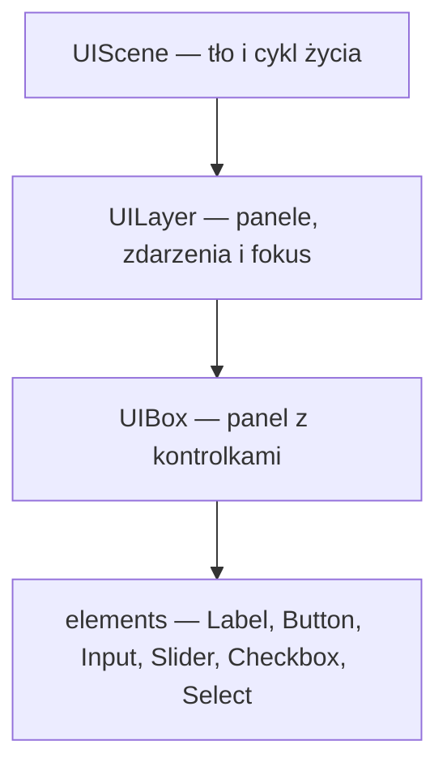
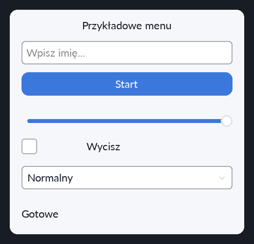

# System UI

UI budujesz w C++: tworzysz scenę, dodajesz panele i umieszczasz w nich kontrolki.
Wygląd opisujesz prostokątami, kolorami, fontami i opcjonalnymi obrazami; zachowanie — callbackami.
Elementy twórz po inicjalizacji SDL, renderera i fontów, najwygodniej w `onEnter()` sceny.

## Struktura



```text
Engine/UI/
├── UILayer.h
├── UIBox.h
├── UIBackground.h
├── README.md
└── elements/
    ├── UIElement.h
    ├── Label.h
    ├── Button.h
    ├── Input.h
    ├── Slider.h
    ├── Checkbox.h
    └── Select.h
```

[UIScene](../Scenes/UIScene.h) łączy UI ze scenami silnika.
`UIElement` definiuje wspólny interfejs kontrolek. `Button` i `Select` dziedziczą po `Label`.
`UIBackground` pomaga rysować kolor i obraz tła sceny, panelu lub etykiety/przycisku.

## Szybki start

Przykład pliku `Game/Scenes/ExampleScene.cpp` pokazuje wszystkie sześć kontrolek.
Bazowa `UIScene` obsługuje przekazywanie zdarzeń, rysowanie i zwalnianie warstwy UI.



```cpp
#include "../../Engine/Scenes/UIScene.h"
#include "../../Engine/Scenes/SceneManager.h"

class ExampleScene : public UIScene {
public:
    ExampleScene() : UIScene({24, 28, 36, 255}) {}

    void onEnter(App& app) override {
        uiLayer = new UILayer(app);
        UIBox* panel = uiLayer->addBox(
            {-1, -1, 480, 460}, {245, 247, 250, 255}, 16, "menu");

        Font font("Assets/fonts/Lato-Regular.ttf", 22, {25, 30, 40, 255});
        Font buttonFont = font;
        buttonFont.color = {255, 255, 255, 255};

        panel->addLabel(font, u8"Przykładowe menu",
                        {0, 0, 0, 0}, {24, 16, 432, 32});
        Label* status = panel->addLabel(font, u8"Gotowe",
                                       {0, 0, 0, 0}, {24, 400, 432, 36});
        status->alignment = Label::Alignment::Left;

        Input* name = panel->addInput(font, u8"Wpisz imię...", {24, 64, 432, 48});
        name->onSubmit = [status](const std::string& value) {
            status->updateText(u8"Witaj, " + value);
        };

        panel->addButton(buttonFont, "Start", {60, 120, 220, 255},
            {24, 128, 432, 48}, 1.05f, [&app]() {
                app.audio.playSound("button.click");
                App::sceneManager->changeScene(createScene2, app);
            });

        panel->addSlider(0, 100, app.settings.volume, {24, 208, 432, 40}, 1,
            [&app](int value) {
                app.settings.volume = value;
                app.applyAudioSettings();
            });

        panel->addCheckbox(app.settings.muted, {24, 264, 32, 32},
            [&app](bool checked) {
                app.settings.muted = checked;
                app.applyAudioSettings();
            });
        panel->addLabel(font, u8"Wycisz", {0, 0, 0, 0}, {72, 264, 240, 32});

        panel->addSelect(font, {u8"Łatwy", u8"Normalny", u8"Trudny"}, 1,
            {24, 320, 432, 48}, [status](int, const std::string& option) {
                status->updateText(u8"Tryb: " + option);
            });
    }
};

Scene* createExampleScene() {
    return new ExampleScene();
}
```

Dodaj deklarację `Scene* createExampleScene();` do `Engine/Scenes/SceneList.h`.
Z istniejącej sceny możesz potem przejść do przykładu przez
`App::sceneManager->changeScene(createExampleScene, app)`.
Pliki `.cpp` w `Game/Scenes` są uwzględniane przez `make build`; uruchamiaj grę przez `make run`.
Ścieżki `Assets/...` odnoszą się do katalogu uruchomienia gry (`build`).

## Pozycjonowanie

- `SDL_Rect` ma postać `{x, y, szerokość, wysokość}` w logicznych współrzędnych UI.
- `UILayer::addBox()` ustawia panel względem całej przestrzeni UI; jej rozmiar zwraca `app.getUISize()`.
- Kontrolki dodawane przez `UIBox::add...()` otrzymują pozycję względem lewego górnego rogu panelu.
- `x = -1` lub `y = -1` centruje na danej osi: panel w UI, a kontrolkę w panelu.
- Po dodaniu `element->rect` zawiera już pozycję w całym UI. `changeRect()` także przyjmuje tę pozycję.
- Centrowanie jest obliczane przy dodawaniu. Po zmianie rozdzielczości układ trzeba przeliczyć lub odbudować.

## Kontrolki i callbacki

Każde `add...()` zwraca wskaźnik, przez który można ustawić wygląd, callback lub wartość.

| Kontrolka | Dodawanie | Najważniejsze API |
|---|---|---|
| `Label` | `addLabel(font, text, color, rect)` | `updateText()`, `alignment` |
| `Button` | `addButton(font, text, color, rect, hoverScale, callback)` | `onClick()` bez argumentów |
| `Input` | `addInput(font, placeholder, rect, type)` | `getText()`, `setText()`, `onChange(text)`, `onSubmit(text)` |
| `Slider` | `addSlider(min, max, value, rect, step, callback)` | `getValue()`, `setValue()`, `onChange(int)` |
| `Checkbox` | `addCheckbox(checked, rect, callback)` | `isChecked()`, `setChecked()`, `onChange(bool)` |
| `Select` | `addSelect(font, options, index, rect, callback)` | `getSelectedIndex()`, `getSelectedText()`, `setSelectedIndex()`, `onChange(index, text)` |

Indeksy `Select` zaczynają się od `0`. `Input::Type::Password` maskuje wyświetlany tekst.
Settery wartości również uruchamiają `onChange`, gdy wartość się zmieni.
Callbacki wykonują się synchronicznie; przejścia scen z callbacków zlecaj przez `SceneManager`.

## Wygląd

Kolor tekstu ustawiasz przez `Font::color`; argument `color` w `addLabel()` i `addButton()` określa tło.
Kolory mają format RGBA: alfa `0` oznacza przezroczystość, a `255` pełne krycie.
`Label::Alignment` przyjmuje `Left`, `Center` i `Right`. `Button::hoverScale` steruje powiększeniem po najechaniu.

Obraz tła można podać jako ostatni argument `addBox()`, `addLabel()` lub `addButton()`.
Scena, panel oraz etykieta/przycisk mają też metody `setBackgroundImage()`,
`setBackgroundOpacity(0..255)` i `clearBackgroundImage()`.
Obraz jest dopasowywany do prostokąta tła.

## Zdarzenia

Gdy korzystasz z bazowej `UIScene`, warstwa UI otrzymuje zdarzenia automatycznie.
Jeśli nadpisujesz obsługę zdarzeń, najpierw pozwól UI je obsłużyć:

```cpp
void handleEvents(App& app, SDL_Event& event) override {
    if (handleUIEvents(event)) return;
    // Tutaj obsłuż pozostałe zdarzenia sceny, np. skrót powrotu do menu.
}
```

- Kliknięcie ustawia fokus kontrolki. `Tab` i `Shift+Tab` przechodzą między kontrolkami obsługującymi fokus.
- `Button` reaguje na naciśnięcie lewego przycisku myszy; obecnie jest pomijany przez nawigację klawiaturą.
- `Input` obsługuje wpisywanie, strzałki lewo/prawo, Home/End, Backspace/Delete oraz Enter (`onSubmit`).
- `Slider` obsługuje przeciąganie, strzałki i Home/End; `Checkbox` — kliknięcie lub Space/Enter.
- `Select` obsługuje mysz, przewijanie listy, strzałki, Home/End i Space/Enter. Lista jest rysowana ponad pozostałym UI.
- Escape zwalnia fokus albo zamyka otwartą listę `Select`. Utrata fokusu okna kończy również przeciąganie.

Panele i kontrolki są rysowane w kolejności dodawania; później dodane interaktywne elementy mają pierwszeństwo przy kliknięciu.
Nadpisując `render()`, wywołaj `UIScene::render(app)`, aby zachować rysowanie UI. `SDL_RenderPresent()` wykonuje `App`.

## Własność i sprzątanie

`UIScene` posiada `uiLayer`, `UILayer` posiada panele, a `UIBox` posiada dodane kontrolki.
Dotyczy to także przekazania własnego obiektu, np. `panel->addButton(new Button(...))`.
Zwróconych wskaźników używaj do konfiguracji; obiekt jest zwalniany przez swojego właściciela.
Nie dodawaj tej samej kontrolki do dwóch paneli. Po usunięciu panelu lub sceny jej wskaźniki są nieważne.

`uiLayer->cleanBox(panel)` usuwa kontrolki i obraz tła panelu, a `removeBox(panel)` usuwa cały panel.
`uiLayer->clean()` usuwa wszystkie panele. Parametr `isClosed = true` w `addBox()` wyłącza interakcję panelu; nadal jest on rysowany.
Bazowa `UIScene::onExit()` zwalnia warstwę. Gdy nadpisujesz `onExit()`, wywołaj także `UIScene::onExit(app)`.

Przykłady użycia w grze: [menu główne](../../Game/Scenes/Scene1.cpp) i [ustawienia](../../Game/Scenes/SettingsScene.cpp).
