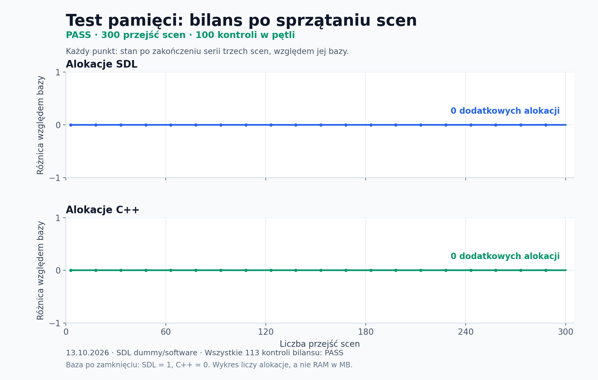
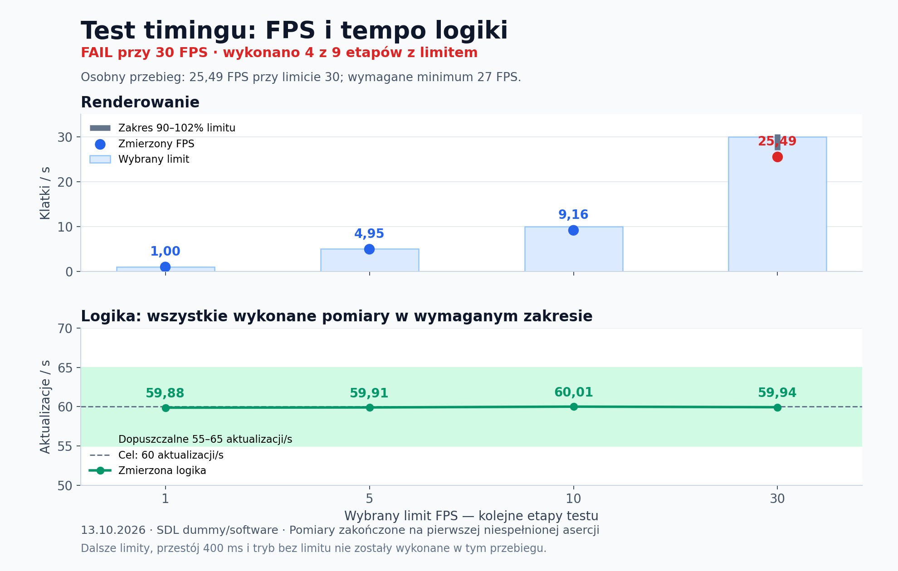

# Testy silnika

Testy używają Catch2 ze wspólnego katalogu **Vendor**. Makefile kompiluje i uruchamia trzy programy.
Raportowanie realizuje listener Catch2 w support/Report.cpp; Makefile nie parsuje tekstu ani XML.

## Podział

| Katalog | Zestawy | Zakres |
|---|---|---|
| unit | Vector2, Velocity | Matematyka i prędkości, bez SDL i plików |
| integration | Collider, MemoryLeaks | Renderer programowy SDL, ECS, sceny, UI, audio i własność zasobów |
| e2e | FrameTiming | Rzeczywista pętla z main.cpp, testowa scena, limity FPS, logika i SDL_QUIT |
| support | Report.cpp, Measurements.h | Wspólny runner, JSON i bufory pomiarów |

Obecnie jest **25 przypadków Catch2**: 14 unit, 10 integration i 1 e2e.
Asercje są liczone osobno. Scenariusz pamięci obejmujący 300 przejść scen jest jednym przypadkiem.

Wszystkie biblioteki są w katalogu projektu: Vendor/SDL2, Vendor/nlohmann, Vendor/Catch2.
Testy SDL działają bez okna i urządzenia audio, na driverach dummy.
Test e2e podmienia scenę na pomiarową; sprawdzenie wyglądu gry i fizycznych urządzeń wymaga osobnego przebiegu.

## Uruchamianie

Wymagania: Windows, GNU Make 4.4+ i MinGW g++ z C++17 w PATH. Zależności są lokalne;
nie potrzeba CMake, CTest, PowerShell ani pobierania pakietów.

**make test** uruchamia wszystkie kategorie kolejno, także po niepowodzeniu pojedynczego testu.
Na końcu drukuje liczbę zaliczonych, niezaliczonych i pominiętych przypadków oraz zapisuje zbiorczy JSON.
Niezerowy kod oznacza błąd testu, kompilacji, raportowania albo niekompletny przebieg.

**make test-unit**, **make test-integration** i **make test-e2e** uruchamiają wybraną kategorię.
Zachowane skróty: make test-vector2, make test-velocity, make test-collider,
make test-memory i make test-frame-timing.

Catch2 i kod raportowania kompilują się raz do wspólnych obiektów.
Programy kategorii są przebudowywane po zmianach źródeł lub nagłówków.
Nie uruchamiaj kilku poleceń testowych jednocześnie w tym samym katalogu.
Podczas pomiaru FPS unikaj innych intensywnych zadań.

## out.json i dane do wykresów

Każdy wykonany **TEST_CASE** tworzy własny plik out.json. Wszystkie pliki są w ignorowanym katalogu build.

| Plik | Zawartość |
|---|---|
| build/tests/out.json | Wynik ostatniego pełnego polecenia make test, podsumowanie i wszystkie kategorie |
| build/tests/unit/out.json | Wyniki ostatniego uruchomienia unit |
| build/tests/integration/out.json | Wyniki ostatniego uruchomienia integration |
| build/tests/e2e/out.json | Wyniki ostatniego uruchomienia e2e |
| build/tests/unit/Vector2/construction/out.json | Przykładowy raport jednego przypadku |
| build/tests/integration/MemoryLeaks/resource-lifecycle/out.json | Próbki alokacji i wynik scenariusza pamięci |
| build/tests/e2e/FrameTiming/main-loop-timing-and-shutdown/out.json | Pomiary pętli aplikacji |

Wspólny format ma schema_version: 1. Raport przypadku zawiera:

- name, suite, category, tags i lokalizację źródła;
- status (passed, failed lub skipped), duration_ms i liczbę asercji;
- failures z komunikatem, wyrażeniem, wartościami i lokalizacją błędu;
- measurements.memory: krok, faza, baza i bieżące liczniki SDL/C++, a także sdl_delta i cpp_delta;
- measurements.frame_timing: limit i zmierzony FPS, current_fps, aktualizacje/s, czas etapu oraz liczbę klatek i aktualizacji;
- measurements.truncated, informujące o przepełnieniu bufora próbek.

duration_ms jest w milisekundach, duration_seconds w sekundach,
a liczniki pamięci oznaczają liczbę aktywnych alokacji, nie bajty ani RAM.
step to kolejność próbek od zera. Dane zapisują się przed sprawdzeniem progów,
więc także nieudany etap FPS lub bilansu pamięci ma wartości do wykresu.
Puste tablice oznaczają brak danego pomiaru w tym przypadku.
limit_fps równy 0 oznacza pracę bez limitu FPS.

Raport kategorii ma summary, assertions i tablicę tests.
Raport zbiorczy ma summary, tablicę categories, complete i missing_categories.
Przy błędzie kompilacji lub awarii procesu brakująca kategoria powoduje complete: false;
runner nie dopisuje fikcyjnych zaliczonych testów.

Pełne uruchomienie usuwa poprzednie raporty kategorii przed startem.
Skrót dla jednego zestawu nadpisuje raport jego kategorii wynikami wyłącznie wybranych przypadków.
Raport zbiorczy aktualizuje tylko make test; pliki pojedynczych przypadków zawierają ich ostatni zakończony przebieg.
Raporty są nadpisywane. Do wykresów porównujących kilka uruchomień zachowaj ich kopie.

Przykładowe pola do wykresów:

- nazwa przypadku → duration_ms;
- step → sdl_delta i cpp_delta (pożądany wynik po sprzątaniu: 0);
- limit_fps → measured_fps i updates_per_second.

## Nowe testy

Dodaj plik .cpp w odpowiednim katalogu i oznacz przypadek kategorią oraz zestawem:

~~~cpp
#include <catch_amalgamated.hpp>
#include "../../Engine/Math/Vector2.h"

TEST_CASE("Adding velocities preserves direction", "[unit][vector2]") {
    const math::Vector2 movement{10.0f, 0.0f};
    const math::Vector2 wind{0.0f, 5.0f};

    const auto result = movement + wind;

    REQUIRE(result.x == Catch::Approx(10.0f).margin(0.00001f));
    REQUIRE(result.y == Catch::Approx(5.0f).margin(0.00001f));
}
~~~

Makefile zbiera pliki .cpp z unit, integration i e2e automatycznie.
REQUIRE kończy bieżący przypadek po błędzie, CHECK kontynuuje asercje,
a REQUIRE_THROWS_AS sprawdza typ wyjątku. Wyniki float porównuj z tolerancją.
Dodatkowe źródła silnika lub biblioteki dopisz do odpowiedniego polecenia kompilacji.

Każdy zwykły przypadek używa asercji Catch2. Test pamięci używa REQUIRE_NOTHROW wokół
całego scenariusza: wewnątrz mierzonego regionu sprawdzenia rzucają wyjątek bez wywoływania frameworka,
żeby raportowanie nie zmieniło bilansu. Próbki trafiają do stałych buforów, a JSON powstaje po zakończeniu pomiarów.

Do ręcznego wyboru przypadku uruchom program z katalogu jego kategorii, np.:

~~~shell
cd build\tests\unit
tests.exe --list-tests
tests.exe "Construction"
~~~

Listener zapisuje out.json względem bieżącego katalogu, również przy takim uruchomieniu.

Opis frameworka: [Catch2](https://github.com/catchorg/Catch2/blob/v3.8.1/docs/tutorial.md).

## Vector2 — działania matematyczne

Uruchom `make test-vector2`. Cel kompiluje test w C++17 z ostrzeżeniami
traktowanymi jako błędy. Nie wymaga SDL ani ECS; używa lokalnej kopii Catch2.

Dziewięć nazwanych testów sprawdza konstrukcję, operatory bez modyfikacji argumentów,
operatory przypisania, długość i iloczyn skalarny, normalizację zwykłego i zerowego wektora,
normalizację bardzo dużych i małych wartości, odrzucanie dzielenia przez zero oraz ruch z `deltaTime`.
Wyniki `float` są porównywane z tolerancją. Catch2 podaje liczbę zaliczonych przypadków,
a przy błędzie wskazuje niespełnioną asercję. Pozostałe przypadki wykonują się także po błędzie.

## Velocity — niezależne źródła prędkości

`make test-velocity` sprawdza sumowanie, zastępowanie i usuwanie nazwanych wektorów,
zerową sumę pustego komponentu oraz znoszenie się przeciwnych prędkości.
Test ECS sprawdza ruch z `deltaTime`, zachowanie źródeł prędkości i pomijanie nieruchomych encji.

## Collidery — podgląd hitboxów

`make test-collider` sprawdza piksele obrysów kwadratu, koła i wielokąta, brak wypełnienia,
włączanie i wyłączanie trybu dev, pozycję i offset oraz podążanie hitboxa za encją.
Sprawdza również wyłączone i niekompletne collidery, nieprawidłowe rozmiary oraz zachowanie
koloru rysowania SDL. Wielokąty obejmują trójkąt, figurę wklęsłą, domknięcie obrysu,
offset, ruch, walidację punktów oraz figurę o 128 wierzchołkach.
Używa renderera programowego i nie wymaga zasobów gry.

## MemoryLeaks — pamięć i cykl życia

Test porównuje liczbę aktywnych alokacji z zapisaną wartością bazową:

- SDL: `SDL_GetNumAllocations()` wraz z `SDLTest_TrackAllocations()`;
- C++: licznik zwiększany przez `new` i zmniejszany przez `delete`.

Najpierw rozgrzewa biblioteki i zasoby, a potem sprawdza powrót do odpowiedniej bazy po sprzątaniu.
Aktywna aplikacja może mieć wiele poprawnie posiadanych alokacji; ważne, żeby zakończony scenariusz nie zmienił bilansu.

| Obszar | Co jest sprawdzane |
|---|---|
| Sceny | 100 serii po trzy sceny, czyli 300 przejść, z kontrolą bilansu po każdej serii |
| Odroczone przejścia | Zmiana i zamknięcie sceny z obsługi zdarzeń, `update`, `render`, `onEnter` i `onExit`; także przejście oczekujące bez aktywnej sceny |
| UI i zasoby | Zmiany tekstów, wartości Input/Select, przeładowanie obrazów i fontów, własność UI oraz wyświetlanie licznika FPS |
| Audio | WAV/OGG, błędne ścieżki i identyfikatory, cache, odtwarzanie, pause/resume, volume/mute, wyczerpanie kanałów i sprzątanie |
| Aplikacja | Destruktory, powtórne `init()`, wielokrotne `clean()` i brak pozostawionych podsystemów SDL |
| Błędy startu | Brak konfiguracji, niewłaściwy driver audio i siedem wymuszonych błędów inicjalizacji |

Siedem wymuszonych błędów obejmuje `SDL_Init`, tworzenie okna i renderera,
`TTF_Init`, `IMG_Init`, `Mix_Init` oraz `Mix_OpenAudio`. Wymuszanie odbywa się przez wrappery linkera.

Wykres pokazuje **różnicę względem bazy po sprzątnięciu każdej serii**, a nie chwilowe zapotrzebowanie podczas tworzenia scen.
Pożądany wynik to `0` dla SDL i C++. W tym przebiegu wszystkie 113 kontroli bilansu przeszły;
100 z nich dotyczyło pętli 300 przejść scen. Baza po zamknięciu aplikacji wynosiła `SDL=1`, `C++=0`.
Ta pojedyncza alokacja SDL należała już do bazy testu i nie przyrastała podczas kolejnych kontroli.

Test mierzy liczbę alokacji, nie RAM w MB ani pamięć GPU. Liczniki nie zastępują sanitizera wykrywającego błędny dostęp do pamięci.

## FrameTiming — FPS i stały krok logiki

Test uruchamia rzeczywistą pętlę z `main.cpp` z własną sceną pomiarową.
Zmienia limit w trakcie działania: **1 → 5 → 10 → 30 → 60 → 120 → 144 → 240 → 5 FPS**,
a na końcu sprawdza tryb bez limitu. Powrót z 240 do 5 sprawdza również zmianę z wysokiego limitu na niski.
Każdy pomiar limitu trwa co najmniej 2,1 s.

| Warunek | Kryterium zaliczenia |
|---|---|
| Ograniczenie FPS | Zmierzony FPS mieści się między 90% a 102% wybranego limitu |
| Tempo logiki | 55–65 aktualizacji/s, niezależnie od wybranego limitu renderowania |
| Krok aktualizacji | `App::deltaTime` wynosi `1/60 s` z tolerancją `0.000001` |
| Licznik FPS | `currentFPS` różni się od wybranego limitu najwyżej o 10% |
| VSync | Renderer nie jest tworzony z `SDL_RENDERER_PRESENTVSYNC` |
| Zatrzymanie na 400 ms | Przy 60 FPS pętla nadrabia pięć aktualizacji, a następna klatka wykonuje najwyżej dwie |
| Tryb bez limitu | Zmierzony FPS i `currentFPS` przekraczają 240, a logika nadal mieści się w 55–65 aktualizacjach/s |
| Zamknięcie | `SDL_QUIT` zostaje odebrane, pętla kończy działanie i nie renderuje ponownie |

Górny panel porównuje limit z uzyskanym FPS; dolny pokazuje tempo logiki i dopuszczalny zakres.
Wartości pochodzą z testowej sceny na rendererze programowym. Wykres obejmuje tylko faktycznie wykonane etapy;
wyniki zależą od maszyny i warunków uruchomienia.

**W przykładowym przebiegu z 13 października 2026 test zakończył się `FAIL` przy 30 FPS:** uzyskał 25,49 FPS,
poniżej wymaganych 27 FPS, mimo prawidłowych 59,94 aktualizacji/s.
Wykres pokazuje cztery wykonane etapy. Dalsze limity, zatrzymanie na 400 ms i tryb bez limitu
nie zostały w tym przebiegu wykonane. Wcześniejszy pomiar równoległy także nie przeszedł progu 30 FPS;
ustalenie przyczyny powtarzającego się wyniku wymaga osobnej diagnozy.

## Jak czytać wynik

- **`All tests passed` / `PASS:` i kod `0`** — wszystkie warunki zostały spełnione.
- **`FAILED` / `FAIL:` i niezerowy kod** — log wskazuje niespełnioną asercję, wyjątek lub awarię procesu.
- Scenariusze pamięci i timingu dodatkowo wypisują własne komunikaty `PASS:` / `FAIL:`.
- W teście pamięci komunikaty o brakujących plikach lub wymuszonych błędach SDL są częścią scenariuszy negatywnych. O wyniku decyduje końcowe `PASS`/`FAIL`.
- `Outstanding allocations changed` oznacza zmianę bilansu. Log podaje wartości SDL i C++ przed scenariuszem oraz po nim.
- `Measured FPS does not match the selected limit` może wystąpić przy przeciążeniu komputera. Powtórz pomiar osobno; jeśli błąd się powtarza, sprawdź timing pętli.

## Dane wykresów

Obrazy PNG są zapisanym przykładem z **13 października 2026**, a nie automatycznie aktualizowanym raportem.
Dane źródłowe: [bilans pamięci](docs/memory-measurements.csv) i [timing](docs/frame-timing-measurements.csv).
Do wykresu pamięci zebrano liczniki z tymczasowej kopii testu, która dopisuje pomiary do logu i zachowuje jego asercje.
Wykres timingu pochodzi z osobnego przebiegu zakończonego `FAIL` przy 30 FPS.

Testy obejmują scenariusze opisane powyżej. Renderowanie na GPU, wygląd UI na monitorze i rzeczywiste przełączanie fullscreen wymagają oddzielnego sprawdzenia.
